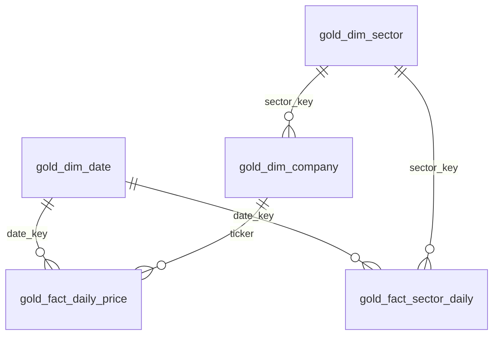

# Gold model and Power BI import guide

## Grain and relationships



All tables are managed Delta tables under `uc:<catalog>.<schema>`. Keys are logical primary/foreign keys; Unity Catalog does not enforce them here. The pipeline ensures source uniqueness for each `MERGE` and the proof notebook checks the fact grain. `date_key` is the integer `yyyyMMdd`, `ticker` is the stable natural company key, and `sector_key` is SHA-256 of the sector name. The date dimension contains observed trading dates, not every calendar day.

| Table | Grain / key | Business columns |
| --- | --- | --- |
| `gold_dim_date` | One observed trading date; `date_key` | `trade_date`, `year`, `quarter`, `month`, `day_of_month`, `day_of_week` (Sunday=1), `year_month` |
| `gold_dim_company` | One current snapshot company; `ticker` | `company_name`, `sector_key`, `sub_industry`, `row_hash` |
| `gold_dim_sector` | One current GICS sector; `sector_key` | `sector` |
| `gold_fact_daily_price` | One ticker per trading date; (`date_key`, `ticker`) | `open`, `high`, `low`, `close`, `adj_close`, `volume`, `dollar_volume_proxy`, `row_hash`, `gold_updated_at` |
| `gold_fact_sector_daily` | One sector per trading date; (`date_key`, `sector_key`) | `company_observations`, `total_volume`, `dollar_volume_proxy`, `gold_updated_at` |

`dollar_volume_proxy = close * volume` is a trading-activity proxy, not exchange-reported dollar turnover. `company_observations` is the number of companies with a valid price on that date; it is not the full index constituent count. Current company/sector labels are applied to historical prices (the source has a fixed constituent snapshot, not historical membership). Do not sum OHLC prices across companies. Summing volume and the dollar-volume proxy over dates or sectors is valid for the stated proxy definition.

## Refresh and audit

The `02_bronze_to_silver.py` notebook now runs Gold after each successful Silver batch. Gold dimensions and daily prices use hash-guarded `MERGE`, so identical replays leave those rows unchanged. The small sector summary is rebuilt from all current Gold prices and companies each run, which removes obsolete groups after a sector change. `04_silver_to_gold.py` performs a complete Gold synchronization from Silver for first deployment or repair. A Silver failure prevents its batch's Gold refresh. The existing `pipeline_execution_logs` table records one row per Gold operation with timing, read/insert/update counts and `rows_aggregated` for the sector summary. `rows_inserted` on the sector summary means rows written by its complete overwrite, not net new keys.

For larger data, replace the complete sector summary overwrite with a date-scoped atomic replacement strategy and consider `OPTIMIZE` after bulk loads. This project does not run `OPTIMIZE` on every small incremental batch because compaction can cost more than the batch itself.

## Import into Power BI

1. In Power BI Desktop, **Get data > Azure Databricks**. Enter the Databricks workspace server hostname and SQL warehouse HTTP path. Choose Import mode for this compact model, authenticate with your organization's supported method, and select the five `gold_*` tables from `catalog.schema`.
2. In Model view, create these active, single-direction, one-to-many relationships: `gold_dim_date[date_key]` to each fact's `[date_key]`; `gold_dim_company[ticker]` to `gold_fact_daily_price[ticker]`; `gold_dim_sector[sector_key]` to `gold_dim_company[sector_key]` and to `gold_fact_sector_daily[sector_key]`. The sector-to-price path runs through company. Keep cross-filter direction single to avoid ambiguity.
3. Mark `gold_dim_date[trade_date]` as the date column if the intended time intelligence works with trading-day gaps; for calendar-based DAX time intelligence, create a separate contiguous calendar table in Power BI. Hide key and row-hash columns in report view.
4. Add the operational tables `pipeline_execution_logs`, `quarantine_prices`, and `schema_drift_log` as separate import tables for audit visuals. They are operational facts with different grains, so keep them outside the price star. Filter `pipeline_execution_logs` to `pipeline_layer LIKE 'SILVER_TO_GOLD%'` to see Gold timings and rows aggregated. Refresh the imported model after the Databricks notebook/job succeeds.

Suggested measures (create each in Model view; use `Selected Close` with one ticker selected):

```dax
Traded Volume = SUM(gold_fact_daily_price[volume])
Dollar Volume Proxy = SUM(gold_fact_daily_price[dollar_volume_proxy])
Priced Companies = DISTINCTCOUNT(gold_fact_daily_price[ticker])
Sector Volume = SUM(gold_fact_sector_daily[total_volume])
Sector Dollar Volume Proxy = SUM(gold_fact_sector_daily[dollar_volume_proxy])
Company Observations = SUM(gold_fact_sector_daily[company_observations])
Selected Close = SELECTEDVALUE(gold_fact_daily_price[close])
Highest Daily High = MAX(gold_fact_daily_price[high])
Lowest Daily Low = MIN(gold_fact_daily_price[low])
Gold Rows Aggregated = SUM(pipeline_execution_logs[rows_aggregated])
Gold Run Seconds = CALCULATE(SUM(pipeline_execution_logs[duration_seconds]), FILTER(pipeline_execution_logs, LEFT(pipeline_execution_logs[pipeline_layer], 14) = "SILVER_TO_GOLD"))
Failed Steps = CALCULATE(COUNTROWS(pipeline_execution_logs), pipeline_execution_logs[status] = "FAILURE")
Quarantined Records = DISTINCTCOUNT(quarantine_prices[record_key])
```

Six visuals to build after import:

1. **KPI cards:** Traded Volume, Dollar Volume Proxy, Priced Companies, and Failed Steps.
2. **Trading activity trend:** line chart with `gold_dim_date[trade_date]` on X and Traded Volume / Dollar Volume Proxy on Y.
3. **Sector comparison:** horizontal bar chart with `gold_dim_sector[sector]` and Sector Volume or Sector Dollar Volume Proxy.
4. **Ticker price trend:** line chart with trading date and Selected Close, with a single-select company/ticker slicer.
5. **Gold execution health:** line or column chart with `pipeline_execution_logs[start_time]` and Gold Run Seconds; filter `pipeline_layer` to `SILVER_TO_GOLD%` or use a run-level visual to avoid mixing step and invocation rows.
6. **Data quality:** bar chart with `quarantine_prices[reject_reason]` and Quarantined Records; add a drill-through table of `schema_drift_log` by `drift_type` and `column_name`.

The operational tables have no shared date relationship to the trading-date dimension by default. Use their own timestamps for audit charts. Avoid summing `Sector Volume` and `Traded Volume` together because they describe the same underlying observations.

No Power BI dashboard file is included in this phase, per the requested scope.
